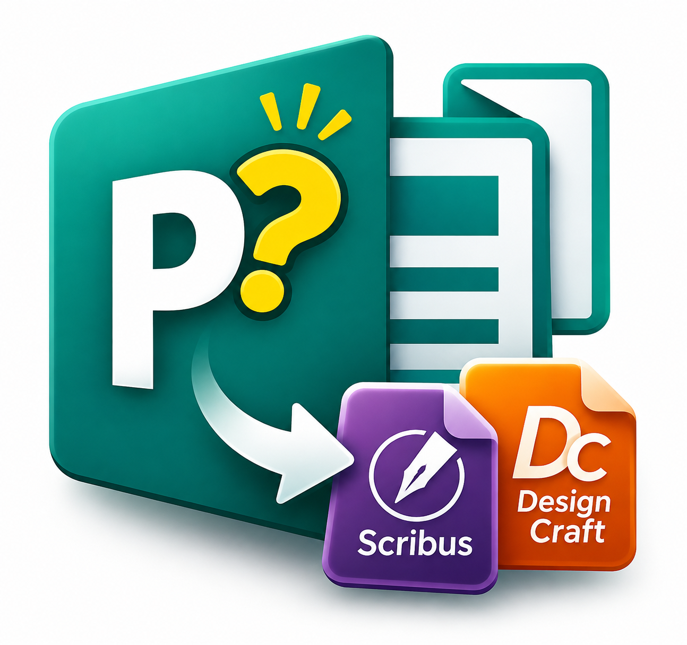

<p align="center"></p>

# Publisher Converter / Convertitore Publisher

**[English](#english) · [Italiano](#italiano)**

---

## English

Microsoft has ended support for Publisher, and anyone with many `.pub` documents risks no longer being able to edit them. This Windows program converts them into documents you can keep working on with [Scribus](https://www.scribus.net/) or with the new DesignCraft. Text stays real text that wraps and flows; frames, lines and borders stay editable objects.

The originals are never changed.

### What it does

- Converts single files, a whole folder with its subfolders, or every `.pub` it finds on your PC (**Search and convert**)
- With **Search and convert** you see the list first, can untick files, and each new document is saved in the same folder as its original
- Interface in English and Italian

### What you need installed

| | |
|---|---|
| **Windows** | Required |
| **Microsoft Publisher** | Required and working: it is what reads the `.pub` files, so the converter cannot work without it |
| **Scribus** or **DesignCraft** | The one for the format you choose. Tested with Scribus 1.6.7 and DesignCraft 0.14, in the standard program folders |
| **The fonts used in your documents** | If they are missing, the look changes. The program can copy them to a `Document Fonts` folder next to the document: DesignCraft loads them by itself, for Scribus they must be installed. Respect the font licenses if you share that folder |

You do not need Python to use the executable.

### Download and use

1. Download `Convertitore-PUB.exe` from the [Releases](https://github.com/derekzoli/pub-converter/releases) page.
2. Open it, choose the format and the files, then click **Convert**.

The executable has no digital signature, so Windows or your antivirus may flag it the first time.

### Known limits

- Tables, WordArt and complex shapes become images, so they cannot be edited
- Line breaks may differ from the original, especially in DesignCraft: always check important documents
- Scribus does not simulate italic for fonts without an italic variant
- Tested on a few real documents, and so far only on the author's PC

### Run from source

```powershell
pip install -r requirements.txt
python "Convertitore PUB.pyw"
python pub2sla.py FILE_OR_FOLDER --formato designcraft
.\crea_eseguibile.ps1      # rebuilds the executable
```

### How it was made

I came up with and tested the application, and it was written with [Claude Code](https://claude.com/claude-code), Anthropic's coding assistant. Publisher opens the document and provides text, shapes and images through its COM interface. The PDF exported by Publisher gives the exact position of each line. Finally the native formats are written: `.sla` for Scribus, `.idml` and `.designcraft` for DesignCraft.

### Author and license

Derek Zoli. Released under the [GNU AGPL-3.0](LICENSE), the same license as PyMuPDF, the library used to read PDFs.

Independent project, not affiliated with Microsoft, Scribus or ArtCraft.

---

## Italiano

Microsoft ha terminato il supporto a Publisher, e chi ha molti documenti `.pub` rischia di non poterli più modificare. Questo programma per Windows li converte in documenti su cui continuare a lavorare con [Scribus](https://www.scribus.net/) o con il nuovo DesignCraft. Il testo resta testo vero, che va a capo e scorre; cornici, linee e bordi restano oggetti modificabili.

Gli originali non vengono mai modificati.

### Cosa fa

- Converte singoli file, un'intera cartella con le sue sottocartelle, oppure tutti i `.pub` che trova sul PC (**Cerca e converti**)
- Con **Cerca e converti** vedi prima l'elenco, puoi togliere la spunta ai file e ogni documento nuovo viene salvato nella stessa cartella del suo originale
- Interfaccia in italiano e inglese

### Cosa serve installato

| | |
|---|---|
| **Windows** | Necessario |
| **Microsoft Publisher** | Necessario e funzionante: è lui che legge i file `.pub`, senza non si può convertire |
| **Scribus** o **DesignCraft** | Quello del formato scelto. Provati con Scribus 1.6.7 e DesignCraft 0.14, nelle cartelle standard dei programmi |
| **I font usati nei documenti** | Se mancano, l'aspetto cambia. Il programma può copiarli nella cartella `Document Fonts` accanto al documento: DesignCraft li carica da solo, per Scribus vanno installati. Rispetta le licenze dei font se condividi quella cartella |

Per usare l'eseguibile Python non serve.

### Scaricare e usare

1. Scarica `Convertitore-PUB.exe` dalla pagina [Releases](https://github.com/derekzoli/pub-converter/releases).
2. Aprilo, scegli il formato e i file, poi clicca **Converti**.

L'eseguibile non ha una firma digitale: la prima volta Windows o l'antivirus possono segnalarlo.

### Limiti da conoscere

- Tabelle, WordArt e forme complesse diventano immagini, quindi non modificabili
- Gli a capo possono cambiare rispetto all'originale, soprattutto in DesignCraft: ricontrolla sempre i documenti importanti
- Scribus non simula il corsivo per i font che non ne hanno uno
- Provato su pochi documenti reali e, per ora, solo sul PC dell'autore

### Avviare dai sorgenti

```powershell
pip install -r requirements.txt
python "Convertitore PUB.pyw"
python pub2sla.py FILE_O_CARTELLA --formato designcraft
.\crea_eseguibile.ps1      # ricrea l'eseguibile
```

### Come è stata fatta

L'applicazione è stata ideata e collaudata da me e scritta con [Claude Code](https://claude.com/claude-code), l'assistente di programmazione di Anthropic. Publisher apre il documento e fornisce testi, forme e immagini attraverso la sua interfaccia COM. Il PDF esportato da Publisher dà le posizioni esatte delle righe. Infine vengono scritti i formati nativi: `.sla` per Scribus, `.idml` e `.designcraft` per DesignCraft.

### Autore e licenza

Derek Zoli. Rilasciato con licenza [GNU AGPL-3.0](LICENSE), la stessa di PyMuPDF, la libreria usata per leggere i PDF.

Progetto indipendente, non collegato a Microsoft, Scribus o ArtCraft.
